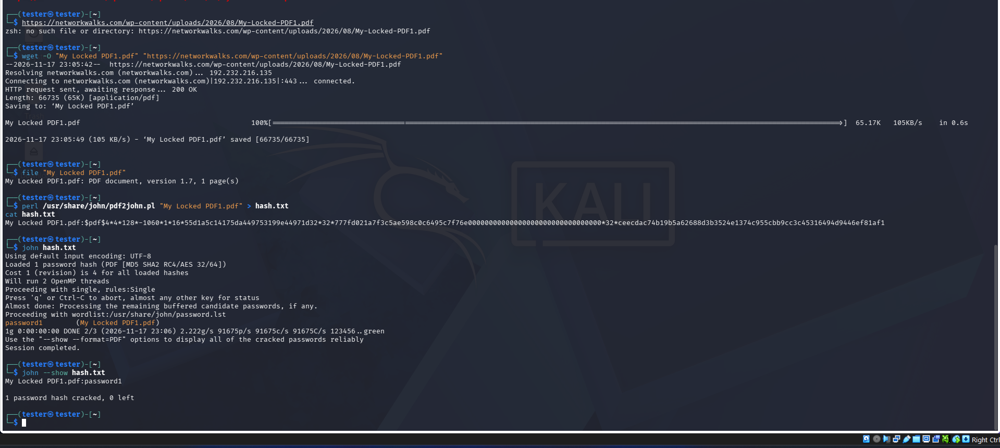
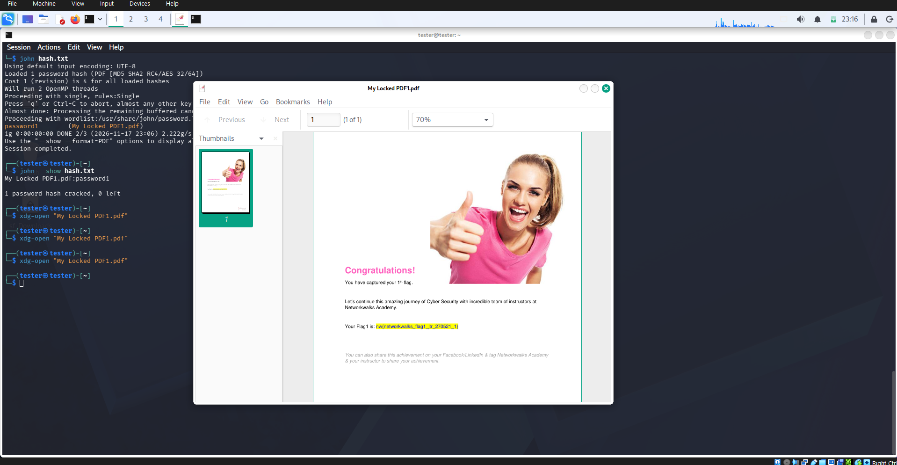
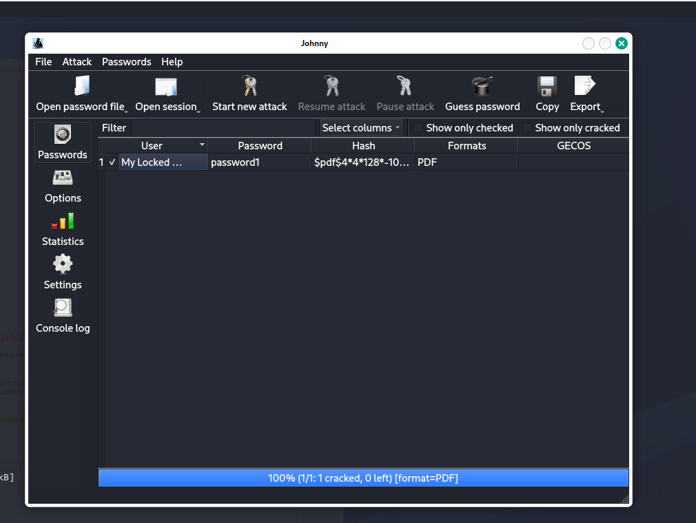
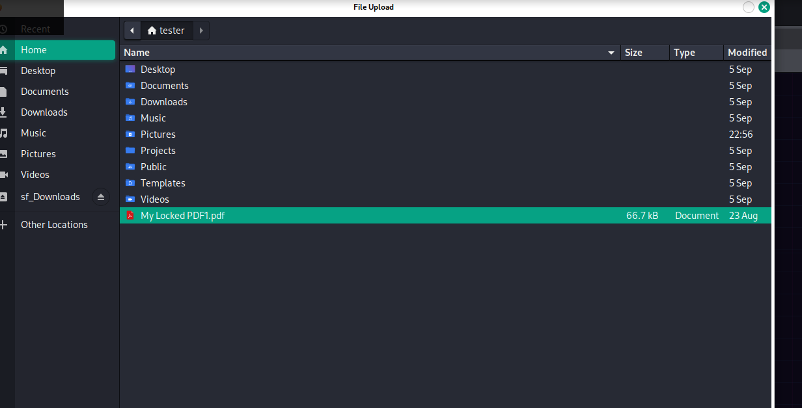
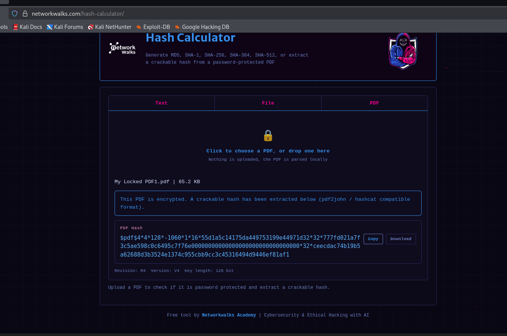
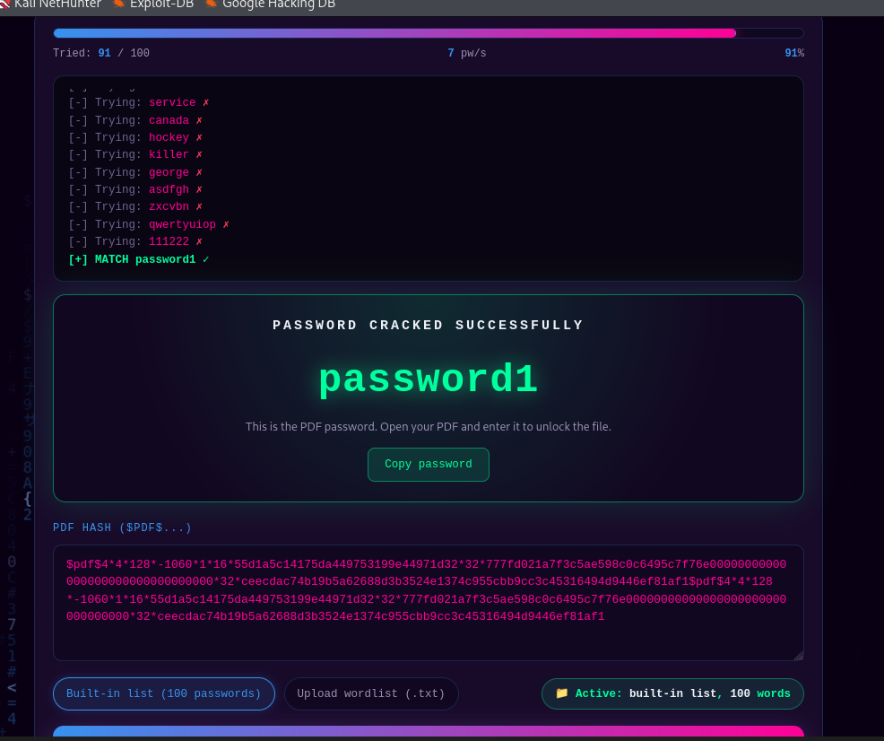

# 🔒 Week 3 — Password Cracking & Hash Analysis Lab

## 📌 Overview
This repository documents the completion of Week 3 compulsory project modules from the **NetworkWalks Cybersecurity & Ethical Hacking training program**. The lab focuses on evaluating password security and hash cracking techniques using both traditional offline tools and modern web-based utilities.

* **Target File:** `My Locked PDF1.pdf`
* **Objective:** Extract cryptographic hashes from a password-protected document and perform dictionary attacks to recover the plaintext password and capture the flag.

---

## 🛠️ Tools & Technologies Used
* **Operating System:** Kali Linux
* **CLI Utilities:** John the Ripper (`1.9.0-jumbo`), `pdf2john.pl`, `john --show`
* **GUI Tools:** Johnny (John the Ripper Graphical User Interface)
* **Web-Based Utilities:** NetworkWalks Hash Calculator & Password Cracker

---

## 🔬 Module 1 — John the Ripper (CLI & GUI)

### **Execution Steps:**
1. **Hash Extraction:** Located `pdf2john.pl` and extracted a crackable hash from `My Locked PDF1.pdf`, saving it to `hash.txt`.
2. **Dictionary Attack:** Executed John the Ripper using the default wordlist (`password.lst`) against the extracted hash.
3. **Verification:** Confirmed the successful decryption using the `john --show` command.
4. **Flag Recovery:** Opened the target PDF using the recovered password (`password1`) to retrieve the flag.
5. **GUI Cross-Verification:** Imported the hash into **Johnny** to validate the attack graphically.

### **Lab Evidence (PM1)**
* **CLI Extraction & Cracking Workflow:**
  

* **Unlocked PDF & Flag Verification:**
  * **Flag Captured:** `nw{networkwalks_flag1_jtr_270521_1}`
  

* **Johnny GUI Execution (100% Success):**
  

---

## 🌐 Module 2 — NetworkWalks Online Tools

### **Execution Steps:**
1. **File Upload:** Uploaded `My Locked PDF1.pdf` to the NetworkWalks Hash Calculator.
2. **Hash Generation:** Automatically parsed the document locally to generate the compatible `$pdf$` hash format.
3. **Automated Cracking:** Ran the dictionary attack via the NetworkWalks Password Cracker utility to instantly recover the key.

### **Lab Evidence (PM2)**
* **File Upload & Selection:**
  

* **Hash Calculator Output:**
  

* **Password Cracked Success:**
  

---

## 💡 Key Takeaway & Conclusion
Both offline command-line tooling (John the Ripper) and automated web interfaces successfully compromised the target document in seconds using standard dictionary lists. This practical exercise demonstrates why weak, predictable credentials like `password1` pose severe security risks and highlights the critical need for complex, entropy-rich passphrases and multi-factor protection.

---
## 👤 Author
Gaurav Ravindra Chalke

LinkedIn: https://www.linkedin.com/in/gaurav-chalke-a55060290/

*Developed as part of the NetworkWalks Cybersecurity & Ethical Hacking training curriculum.*
